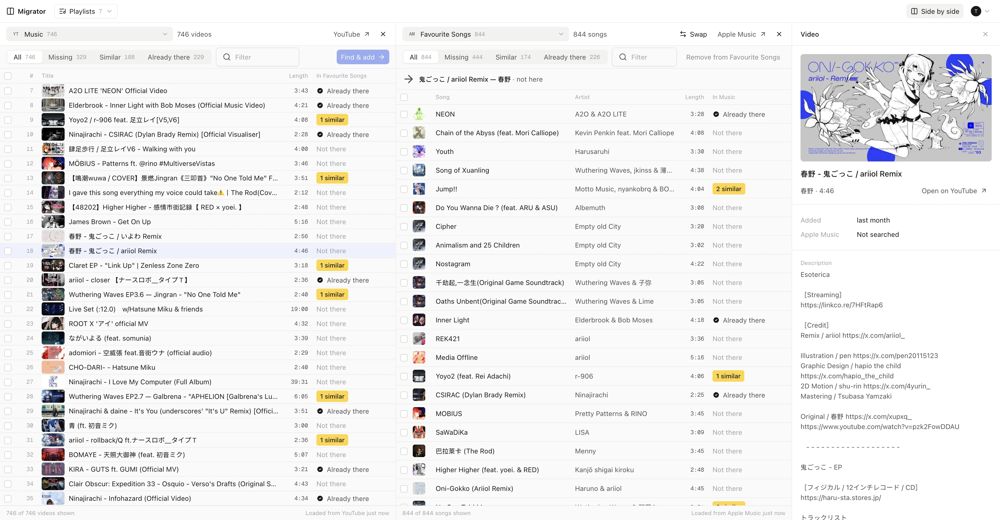
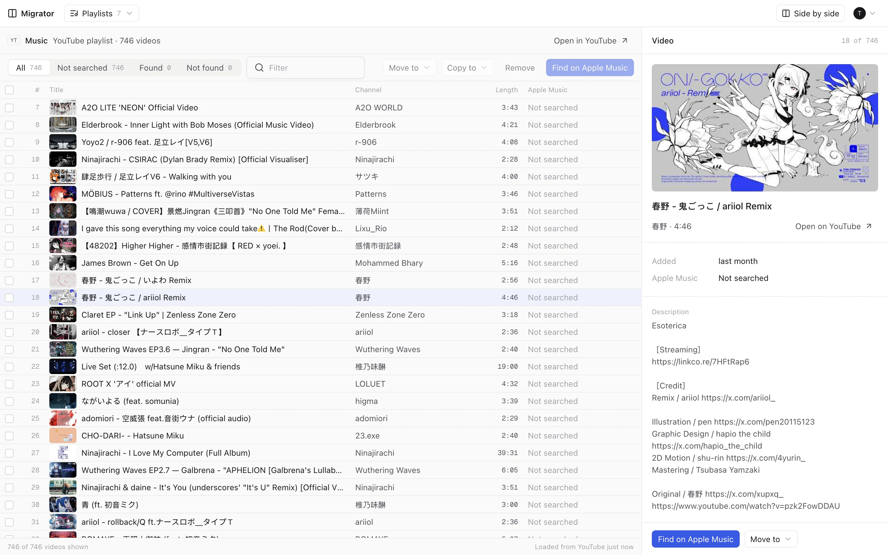
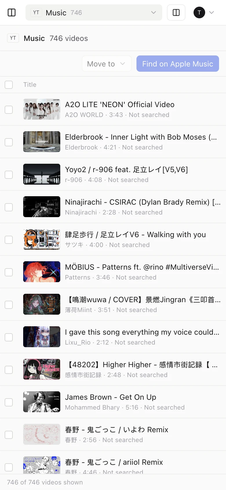

# Migrator

Manage playlists across YouTube and Apple Music. Pick YouTube videos, search Apple Music for them,
review the matches, then add them to Apple Music playlists or move the leftovers to another YouTube
playlist. Nothing is written to either service until you apply a decision.

The app is the only way to manage music. One-off scripts go in `scripts/` (see [Scripts](#scripts)).

Live: https://music-manager.frixaco.com (Google sign-in is limited to test users while the OAuth app
is in Testing mode).



| Playlist with details                                                           | Mobile                                                       |
| ------------------------------------------------------------------------------- | ------------------------------------------------------------ |
|  |  |

## Features

- **Playlists:** open any YouTube or Apple Music playlist. Rows show thumbnails; click one for its
  details and link. Select by checkbox, Shift-click, or dragging (Shift adds, Ctrl/⌘ removes).
- **Find on Apple Music:** a match run searches the Apple Music catalog for the selected videos and
  shows several candidates per video with a confidence. You review every match; nothing is added
  automatically. Results stay until you close the run, so leftovers can be moved on.
- **Side by side** (`/split`): two playlists at once. Each row says whether it is already in the
  other playlist, similar to something there, or missing; click a row to see the candidates. Copy or
  move YouTube → YouTube, find and add YouTube → Apple Music, add Apple Music → Apple Music. Apple
  Music → YouTube is comparison only.
- **Apple Music limits:** only playlists the app can edit (and Favourite Songs) accept songs.
  Favourite Songs is filled by favouriting songs, and Apple controls its order. Songs are added from
  the catalog of your storefront, so region-locked songs can't be added.

## Stack

TanStack Start (React), TanStack Query, shadcn/ui on Tailwind, Better Auth (email/password and
Google), Drizzle on Postgres. Deployed on Railway.

## Layout

| Path                                 | What                                                                                                                       |
| ------------------------------------ | -------------------------------------------------------------------------------------------------------------------------- |
| `src/routes`                         | Pages: sign-in, connect, YouTube and Apple Music playlists, match run                                                      |
| `src/functions`                      | Server functions called from the client                                                                                    |
| `src/server/*.server.ts`             | Server-only code: YouTube and Apple Music clients, matching runner, auth middleware                                        |
| `src/components/ui`                  | shadcn components, restyled to the design tokens in `src/styles.css`                                                       |
| `src/components`                     | App components built from them                                                                                             |
| `src/db`                             | Drizzle schema (`auth-schema.ts` is generated by Better Auth)                                                              |
| `src/lib`                            | Shared code: matching (`matching.ts`), side-by-side comparison (`compare.ts`), the Apple Music client, queries, formatting |
| `src/hooks`                          | Row selection (click, Shift, drag) and the active row                                                                      |
| `scripts/`                           | One-off Bun scripts                                                                                                        |
| `drizzle/`                           | SQL migrations                                                                                                             |
| `data/raw/youtube_playlist_raw.json` | Fixture for checking that matching results stay the same                                                                   |
| `docs/screenshots`                   | README screenshots                                                                                                         |

## Local development

Needs Bun and Postgres (Homebrew `postgresql@18`; if it's down:
`pg_ctl -D /opt/homebrew/var/postgresql@18 start`).

```sh
cp .env.example .env     # then fill it in
createdb migrator
bun install
bun run db:migrate
bun run dev              # http://localhost:3000
```

`.env` needs:

- `DATABASE_URL`, `BETTER_AUTH_URL`, `BETTER_AUTH_SECRET`
- `GOOGLE_CLIENT_ID` and `GOOGLE_CLIENT_SECRET` from the "Migrator web" OAuth client in the `frixaco`
  Google Cloud project. Its redirect URIs are `https://music-manager.frixaco.com` and `http://localhost:3000`, ending in
  `/api/auth/callback/google`. The app is in Testing mode, so only listed test users can sign in with Google.
- The MusicKit key: `APPLE_TEAM_ID`, `APPLE_KEY_ID`, `APPLE_MEDIA_ID`, and either
  `APPLE_PRIVATE_KEY_PATH` (local) or `APPLE_PRIVATE_KEY` (the PEM contents, on Railway). The app
  signs a developer token from it; each user connects Apple Music with MusicKit on `/connect`, and
  their storefront is detected from their account.

Signing in and connecting:

- Connect YouTube from a browser on the same machine at `http://localhost:3000`. LAN addresses
  aren't registered redirect URIs, and finishing the Google callback in another browser fails with
  `state_mismatch`.
- Google tokens only refresh with the client that issued them. If YouTube pages fail with "Failed to
  get a valid access token", reconnect on `/connect` with **Switch account**.
- The local database has one user, `test@migrator.local`. The app uses the most recently updated
  YouTube connection.

Checks:

```sh
bun run typecheck && bun run lint && bun run build
```

Schema changes: edit `src/db/schema.ts`, then `bun run db:generate` and commit the new migration.

## Deploy

Railway project `main`, service `migrator`, using the `migrator` database on that project's shared
Postgres. Pushes to `main` on GitHub deploy automatically. Migrations run before each deploy.
Service settings live in `.railway/railway.ts`; apply changes with `railway config plan` and
`railway config apply`. Variables are managed in Railway, not in that file.

It runs as a single replica (match runs are locked per process). The healthcheck is
`/api/auth/ok`. A deploy can sit in DEPLOYING for several minutes after migrations finish; follow it
with `railway deployment list --service migrator` and `railway logs --service migrator <id>`.
The custom domain `music-manager.frixaco.com` (port 8080) is a CNAME in Vercel DNS for `frixaco.com`.

## Scripts

Scripts run with Bun, read `.env` and can import anything under `src` through `@/`. Use
`appleForUser` and `youtubeForUser` from `src/server` to get API clients for a user's connected
accounts; see `scripts/list-playlists.ts`.

```sh
bun scripts/list-playlists.ts you@example.com
```

Apple Music API notes:

- Favouriting a song (`POST /v1/me/favorites?ids[songs]=<id>`) is how it gets into Favourite Songs,
  which can't be edited directly. The endpoint takes one id per request. Removing means clearing the
  library song's rating. Apple controls that playlist's order.
- Reading an empty library playlist returns error `40403`; treat it as empty.
- To check whether songs exist in a storefront, look them up by id
  (`/v1/catalog/{storefront}/songs?ids=…`) rather than relying on search ranking. Region-locked songs
  return nothing, and album listings can silently leave tracks out. The `jp` storefront returns
  Japanese titles where others return English or romaji.
